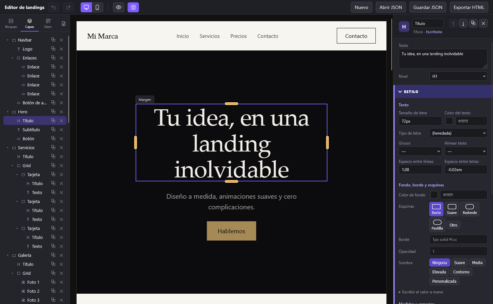
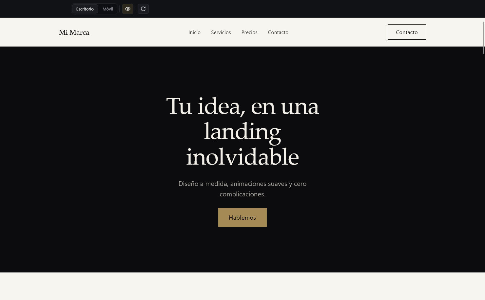
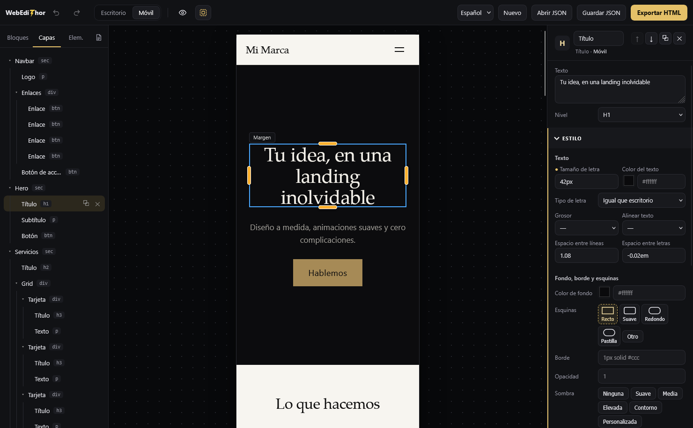

<div align="center">

# ⚡ WebEdiThor <sub>by [m3nt41](https://github.com/m3nt41)</sub>

**A visual editor for animated landing pages. Build it in the browser, export clean HTML, keep everything.**

[](LICENSE)


[**Live demo**](https://webedithor.m3nt41.com) · [Quick start](#-quick-start) · [What you can do](#-what-you-can-do) · [How it works](#-how-it-works) · [Status](#-status-and-honest-limits) · [Roadmap](ROADMAP.md) · [Contributing](CONTRIBUTING.md)

</div>

<!-- TODO (polish phase): logo above the title and an animated GIF (docs/assets/demo.gif) next to these screenshots. -->

<p align="center">
  
</p>

<table>
  <tr>
    <td width="62%"></td>
    <td width="38%"></td>
  </tr>
  <tr>
    <td align="center"><sub><b>👁 Preview</b>: the real exported HTML, not a simulation</sub></td>
    <td align="center"><sub><b>Mobile view</b>: only what changes is stored</sub></td>
  </tr>
</table>

> 🚀 **Try it now, nothing to install: [webedithor.m3nt41.com](https://webedithor.m3nt41.com).** Your work stays in your browser, so use **Guardar JSON** to keep a copy. For a complete sample landing, press **Abrir JSON** and pick [`docs/demo-estilo.json`](docs/demo-estilo.json).

---

## Why WebEdiThor

Most visual builders host your site, own your data and hand you markup you can't use anywhere else. WebEdiThor goes the other way:

- 🧱 **Pages are real files.** The export is a single `.html` with the CSS inline. Open it, host it anywhere, edit it by hand.
- 🔓 **No lock-in.** Your page is also a plain JSON tree you can save, diff, version in git and re-import.
- 🏠 **Nothing to host.** The editor runs 100 % in your browser. No backend, no account, no CMS, no tracking.
- 🎬 **Motion first, CSS first.** Entrance animations, hovers, scroll effects and scenes are exported as plain CSS whenever CSS can do it. JavaScript only ships when a page actually uses a feature that needs it.
- 🧩 **Extensible by design.** Every animation is its own module and every block is its own file, so adding one doesn't break the rest.

## ✨ What you can do

| | |
|---|---|
| **Blocks** | 10 blocks and 41 variants: navbar, hero, services, gallery, testimonials, pricing, scroll scene, marquee, contact, footer. One consistent visual theme. |
| **Edit visually** | Click to select, double-click to edit text, drag spacing handles right on the canvas, undo/redo, layers tree, desktop and mobile views (mobile only stores what changes). |
| **Animate** | Appear (fade, slide, zoom, blur, rotate), per-letter / word / line text reveals, stagger, hover / press / focus, named states with transitions, spring and cubic-bezier curves. |
| **Scroll** | Native-CSS parallax, scroll-linked effects, sticky, multi-step scroll scenes, optional smooth scroll ([Lenis](https://github.com/darkroomengineering/lenis)). |
| **Preview exactly** | The 👁 preview is an iframe with the *real exported HTML*, so what you see is what you ship. |
| **SEO and sharing** | Page language (`<html lang>`), meta description, and Open Graph / Twitter card with a share image, all set in the page settings. Nothing is added to the export unless you fill them in. |
| **Respect users** | `prefers-reduced-motion` is honoured; the export is quiet and fully visible without JavaScript. |
| **Draft with AI, optionally** | Copy a generated guide into any chat assistant, paste its JSON "plan" back, and the editor builds the page. No API key, no server. |

The official, always-up-to-date list of animations and what is done or pending lives in [`FEATURES.md`](FEATURES.md).

## 🚀 Quick start

You need [Node.js](https://nodejs.org) **20.19+** (or 22.12+).

```bash
git clone https://github.com/m3nt41/webedithor.git
cd webedithor
npm install
npm run dev
```

Open <http://localhost:5173> and start building.

**Prefer a double-click editor?** Build it once and you get a standalone file that runs without a server:

```bash
npm run build
```

Then open `dist/editor.html` (on Windows, `abrir-editor.bat` does it for you).

> 💾 **Where is my work saved?** In your browser's `localStorage`, plus **Guardar JSON / Abrir JSON** for files. `localStorage` is per address, so the dev server (`http://localhost:5173`) and the standalone `file://` editor don't share pages: move work between them with a JSON file.

**Exporting:** use the export button in the toolbar to download your page as a single `.html`.

## 🧰 The CLI (early)

A small companion that **complements** the editor: scaffold a project, audit the result, export, and prepare it for publishing. It has no dependencies and reuses the editor's own exporter, so its output is identical to the **Exportar HTML** button.

```bash
npx webedithor create my-site --template landing
cd my-site
npx webedithor dev                                  # opens the visual editor
npx webedithor audit page.json                      # a11y, links, heavy assets, basic SEO
npx webedithor export page.json -o dist/index.html
npx webedithor publish page.json --to static        # prepares a folder; uploads nothing
```

It is on npm as [`webedithor`](https://www.npmjs.com/package/webedithor) (v0.1.0, early). See [`cli/README.md`](cli/README.md) for every command, what `audit` checks, and how the editor and the project folder talk to each other (via JSON files, for now).

## 🔧 How it works

```text
 ┌──────────────┐   mutate()   ┌────────────┐   render   ┌───────────────┐
 │  Inspector   │ ───────────▶ │  JSON tree │ ─────────▶ │ Canvas (DOM)  │
 │  & sidebar   │ ◀─────────── │  (store)   │            └───────────────┘
 └──────────────┘  subscribe   └─────┬──────┘
                                     │ export
                                     ▼
                         one static .html (CSS-first)
```

- The page is a JSON tree: `page > section > elements`. Each node holds its styles (`base` and `mobile`), content, animation and children.
- Layout is always flex or grid, never free absolute positioning, so exports stay responsive.
- `src/core/store.js` is the single source of truth; every change goes through `mutate()`, which is also what powers undo/redo.
- Pieces shared by editor and export (icons, marquee, mobile menu, backgrounds) have **one** generator each, so they can't drift apart.

```text
src/
  core/        tree, store, shared generators, AI plan importer
  blocks/      one file per block + the visual theme
  animations/  one module per animation
  render/      tree -> editor DOM
  export/      tree -> standalone .html
  ui/          sidebar, canvas, inspector, toolbar, preview
cli/           companion command-line tool (own package, reuses the exporter)
tests/         browser tests (Selenium / Firefox) and unit-style checks
docs/          sample landings, AI guide, audits, history
```

## 📊 Status and honest limits

WebEdiThor started as a personal tool for building heavily animated landing pages, and it is usable today. It is **early** and has rough edges:

| Area | State |
|---|---|
| Structure, tree, inspector, export, mobile, JSON, undo/redo | ✅ Done |
| Animations: appear, text, hover/press/focus, states, transitions | ✅ Done |
| Scroll: parallax, scroll-linked, sticky, scenes, smooth scroll | ✅ Done |
| Advanced motion (drag, inertia, layout animations, 3D) | 🔜 Planned |
| Custom cursor, page transitions | 🔜 Planned |
| Companion CLI (`create`, `audit`, `export`, `dev`, `publish`) | 🧪 Early (v0.1.0), on npm: `npx webedithor` ([details](cli/README.md)) |

Things you should know before you try it:

- 🌐 **The editor interface is currently in Spanish** (`Guardar JSON`, `Vista previa`...). Translating it is on the [roadmap](ROADMAP.md); the exported pages contain whatever language *you* write.
- 🖼️ Uploaded images are embedded as data URLs, which can make the `.html` and the JSON heavy. Prefer image URLs for big assets.
- 🔤 Only system fonts are used, so exports never depend on the internet.
- 🧪 Requires a modern browser (2023+): individual `translate` / `scale` and `linear()` easing. Developed and tested mostly in **Firefox**; Chrome works too.
- 🧪 `audit` contrast checks are approximate (plain colors only).
- 📚 Internal notes (`PROGRESS.md`, `docs/historial.md`, audits) are written in Spanish.

The full list of known limitations is in [`PROGRESS.md`](PROGRESS.md).

## 🧭 Roadmap

Short version: advanced motion → extras → grow the companion CLI (saving into a project folder, real templates) → polish (tutorial, translations, public demo). Details, ideas and what is *not* planned are in [ROADMAP.md](ROADMAP.md).

## 🤝 Contributing

Bug reports, ideas, new block variants and new animations are welcome. Start with [CONTRIBUTING.md](CONTRIBUTING.md); please also read the [Code of Conduct](CODE_OF_CONDUCT.md). Found a security issue? See [SECURITY.md](SECURITY.md).

## 🙏 Built with

- [Vite](https://vite.dev) and [`vite-plugin-singlefile`](https://github.com/richardtallent/vite-plugin-singlefile): dev server and single-file build.
- [Lenis](https://github.com/darkroomengineering/lenis) (MIT): optional smooth scroll, inlined in an export only when enabled.
- [Lucide](https://lucide.dev) icons (ISC): the 41 built-in line icons.
- [Motion](https://motion.dev) (MIT) is installed for the upcoming advanced-motion stage and not used yet.

## 📄 License

[MIT](LICENSE) © 2026 m3nt41. Do what you want with it, and with the pages you make.
